<div align="center">

# ◆ QuestTUI

**Your everyday to-do list, written like a quest log.**

A terminal task manager inspired by 16-bit adventure games: split tasks into steps,
track the one that matters, and get a small celebration every time you finish something.

[](https://go.dev)
[](https://github.com/charmbracelet/bubbletea)
[](LICENSE)


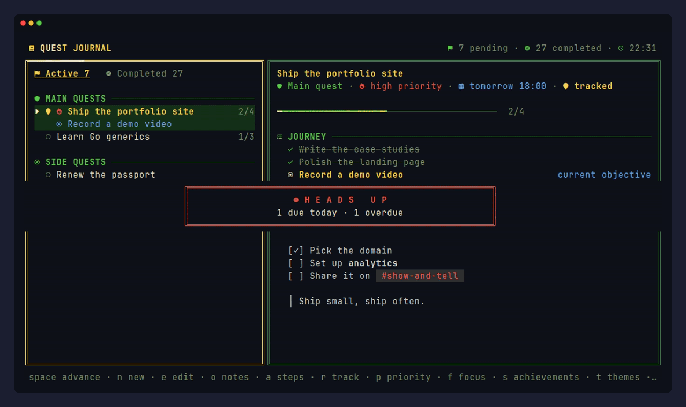

</div>

---

## Contents

- [Features](#features)
- [A tour](#a-tour)
- [Installation](#installation)
- [Getting started](#getting-started)
- [Keyboard shortcuts](#keyboard-shortcuts)
- [Command line](#command-line)
- [Configuration](#configuration)
- [Recording the demos](#recording-the-demos)

## Features

| | |
|---|---|
| **Quests with steps** | Main quests and side quests, broken into steps. `space` completes the current objective and moves on to the next one, like a real quest log. |
| **Due dates in plain words** | `today`, `tomorrow 14h`, `friday`, `+3d`, `20/11 14:00`. Overdue quests turn red. |
| **Priority and manual order** | Push urgent quests to the top and reorder the rest with `shift ↑ ↓`. |
| **Tracked quest** | Pin the quest you are working on; it gets the spotlight everywhere. |
| **Vigil mode** | A screensaver-like clock that shows what is left to do, with a focus timer. |
| **Markdown notes** | A built-in editor with live preview, formatting shortcuts, list continuation, a vim mode, and an escape hatch to your real `$EDITOR`. |
| **Achievements** | Streaks, best days, weekly charts and medals, all from your own history. |
| **Reminders** | Native notifications on Windows (through WSL) or Linux, even with the journal closed. |
| **Made to look good** | Six themes, Nerd Font icons, animated borders, particles, fireworks, optional sound effects. |
| **Two languages** | English and Portuguese, switchable at any time with `^L`. |

## A tour

### The journal

Quests on the left, the selected quest on the right: its steps, the current objective, its due date and your notes.

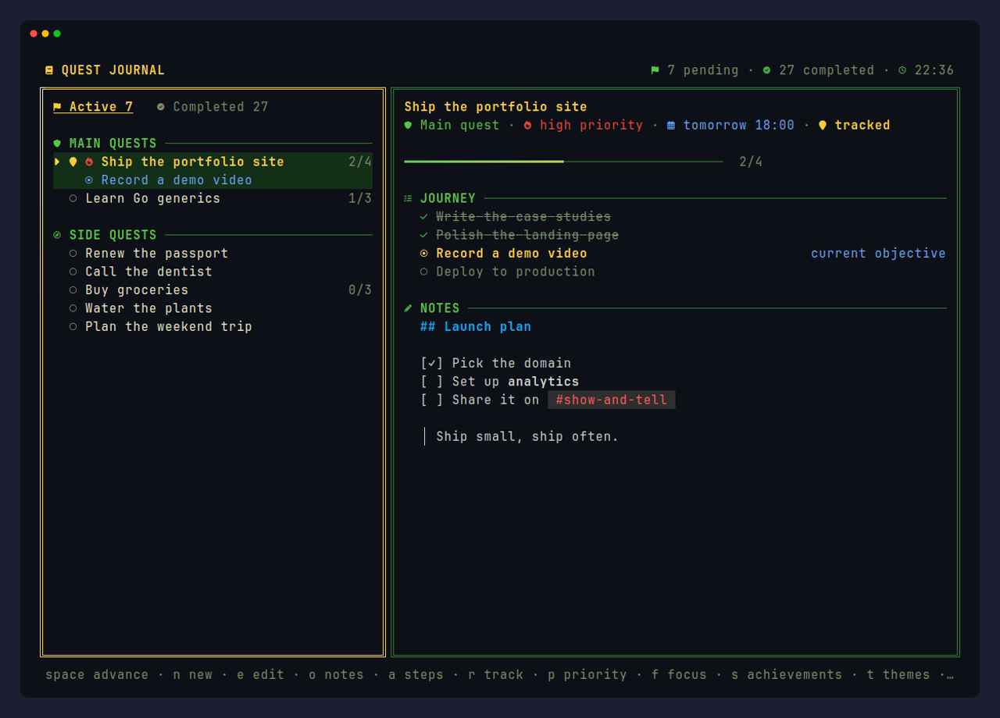

### Every action has its own effect

Creating a quest, tracking it, abandoning it: each one gets its own banner and particles.

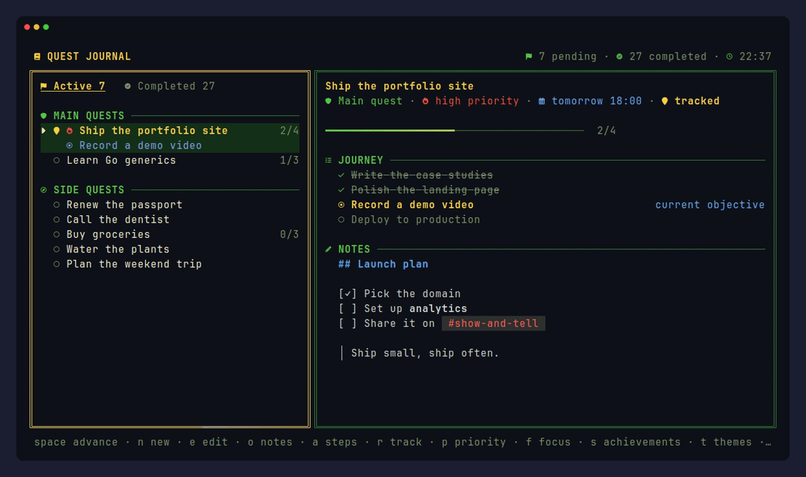

### Clear the board, get fireworks

Finish the last pending quest and the whole screen celebrates.

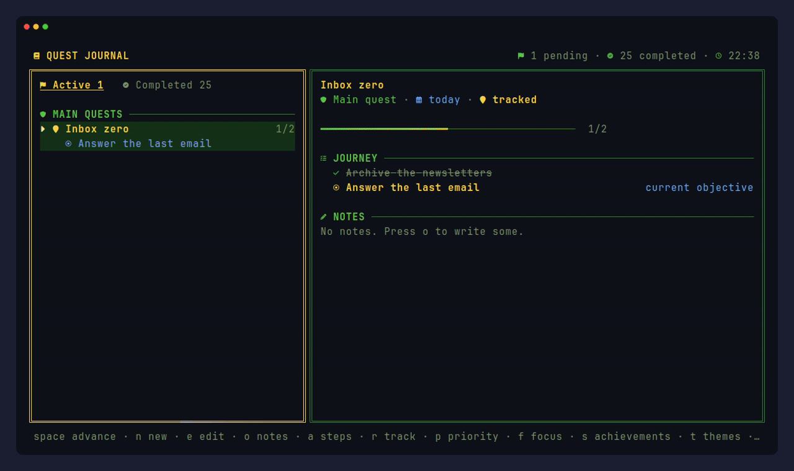

### Vigil mode

Press `z`, or just leave the journal idle. A big clock, the date, the tracked quest with its progress,
everything still left to do, a running focus timer, and a sky that slowly drifts (watch for shooting stars).

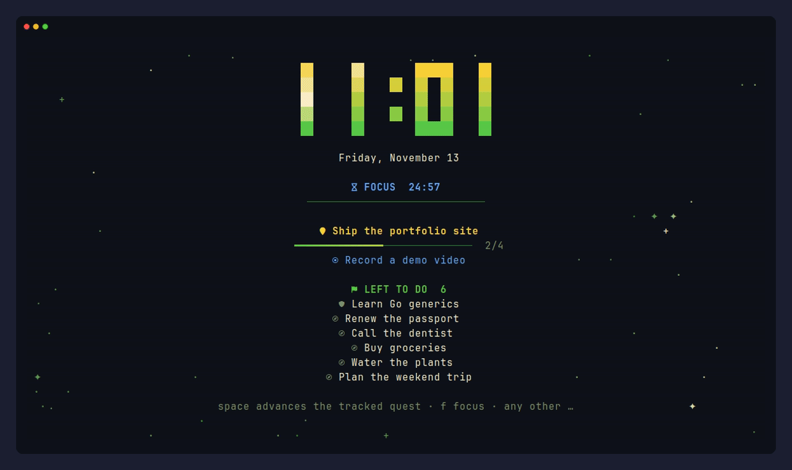

### Notes with a real editor

Press `o` to write notes in markdown. The preview updates as you type, lists and checkboxes continue on
`enter`, and `alt` shortcuts handle formatting. Prefer vim? Press `^T` for a built-in vim mode, or `^E`
to open the note in your own editor.

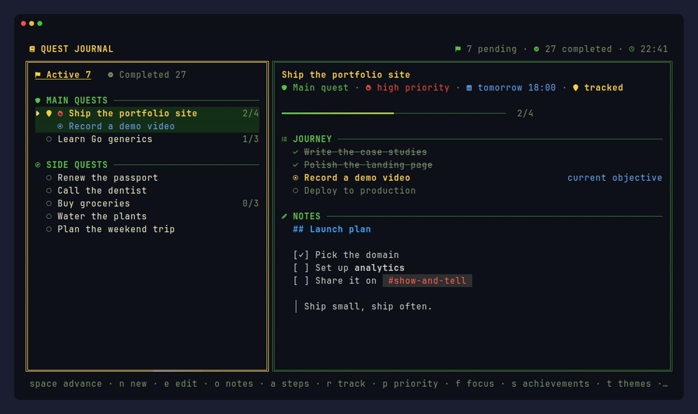

### Themes

`heroi`, `reino`, `sombrio`, `masmorra`, `cristal` and `mono`, or your own.

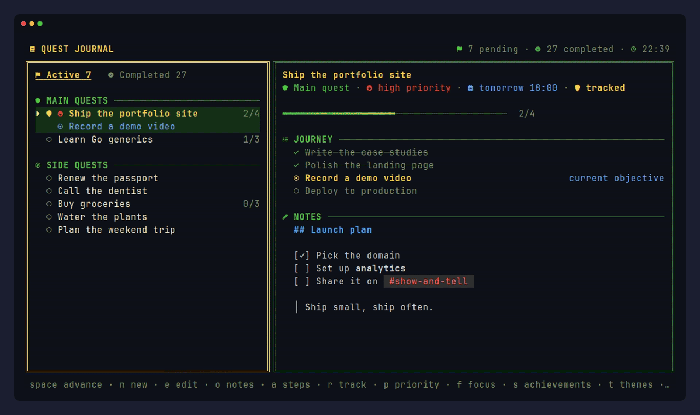

### Achievements

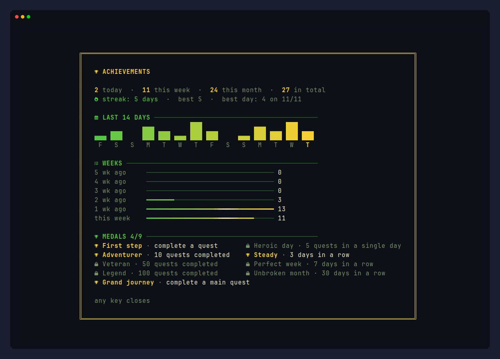

<details>
<summary><b>More screenshots</b></summary>

<br>

**Editing a quest**

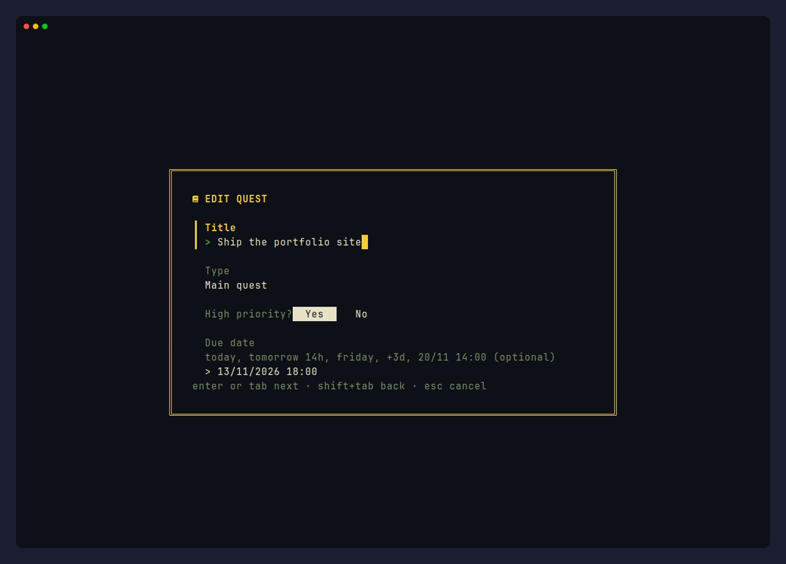

**Completed quests, grouped by day**

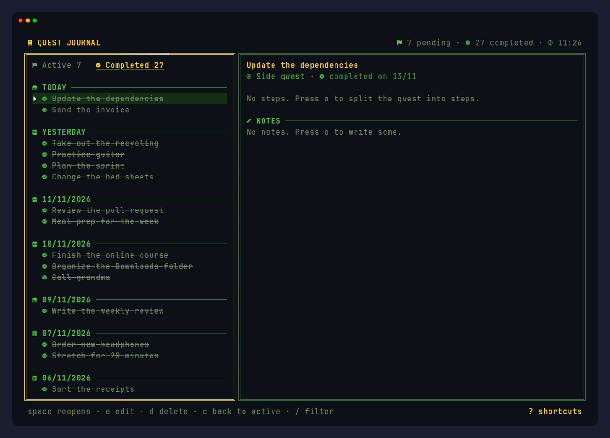

**Built-in help**

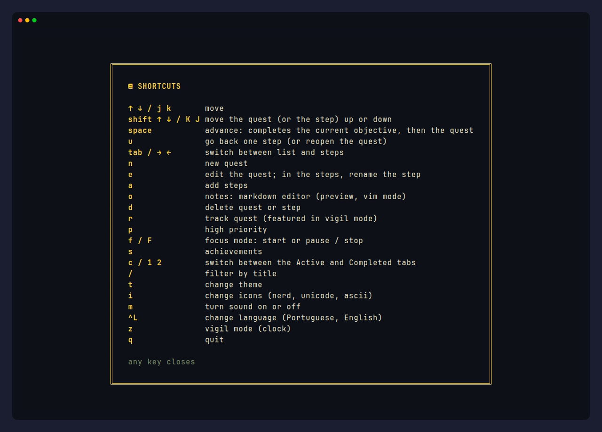

</details>

## Installation

You need [Go 1.27+](https://go.dev/dl/) and a terminal with a [Nerd Font](https://www.nerdfonts.com/)
(the icons fall back to plain Unicode or ASCII if you don't have one: press `i`).

```bash
git clone https://github.com/migueldsants/QuestTUI.git
cd QuestTUI
go build -o quest .
```

Then put `quest` somewhere on your `PATH`, for example `~/.local/bin`.

> **Windows:** QuestTUI runs inside [WSL](https://learn.microsoft.com/windows/wsl/). Build and run it from
> your Linux distribution; reminders still show up as native Windows notifications.

## Getting started

```bash
quest                                   # open the journal
quest add "Buy groceries" --due today   # quick capture
quest add "Ship the site" --main --priority --due "fri 18:00"
quest list                              # pending quests
quest done 3                            # complete quest #3
```

In the journal: `n` creates a quest, `a` adds steps, `space` advances, `r` tracks, `o` opens the notes, and `?` shows every shortcut.

## Keyboard shortcuts

### Journal

| Key | Action |
|---|---|
| `↑ ↓` / `j k` | move |
| `shift ↑ ↓` / `K J` | reorder the quest or step |
| `space` | complete the current objective, then the quest |
| `u` | go back one step / reopen |
| `tab` | switch between the list and the steps |
| `n` / `e` | new quest / edit |
| `a` | add steps |
| `o` | notes |
| `d` | delete |
| `r` | track |
| `p` | high priority |
| `f` / `F` | focus timer: start or pause / stop |
| `s` | achievements |
| `c` / `1` `2` | active and completed tabs |
| `/` | filter |
| `z` | vigil mode |
| `t` | themes |
| `i` | icons: Nerd Font, Unicode, ASCII |
| `m` | sound on or off |
| `^L` | English / Portuguese |
| `?` | help |
| `q` | quit |

### Notes editor

| Key | Action |
|---|---|
| `^S` | save |
| `^Q` / `esc` | close (saves) |
| `^P` | live preview |
| `^F` | full screen |
| `^T` | vim mode |
| `^E` | open in `$EDITOR` |
| `^G` | shortcuts panel |
| `^Z` / `^Y` | undo / redo |
| `^K` / `^U` | cut line / paste |
| `alt+b` `alt+i` `alt+s` | bold, italic, strikethrough |
| `alt+c` / `alt+k` | code / link |
| `alt+1` `2` `3` | heading |
| `alt+l` / `alt+t` | list / task (toggle done) |
| `alt+q` | quote |

**Vim mode:** normal, insert and visual modes; `hjkl w b e 0 ^ $ gg G { }`; `d c y` with motions;
`dd yy cc p P x D C J ~ r`; `u` and `^R`; `/` search with `n N`; counts like `3j` and `2dd`;
and `:w`, `:q`, `:wq`, `:q!`, `:<line>`.

## Command line

| Command | |
|---|---|
| `quest` | open the journal (`--vigil` starts in vigil mode) |
| `quest add <title>` | create a quest: `--due`, `--main`, `--priority`, `--note` |
| `quest list` | list pending quests |
| `quest done <id>` | complete a quest |
| `quest lang <en\|pt>` | switch the language |
| `quest reminders` | send pending due-date notifications |
| `quest reminders --install` | on Windows/WSL, check every 15 minutes even with the journal closed |
| `quest reminders --test` | show a test notification |

Every option also accepts its Portuguese name (`--prazo`, `--principal`, ...).

## Configuration

Settings live in `~/.config/questtui/config.toml` and are saved as you change them in the app.

```toml
theme = "heroi"           # heroi, reino, sombrio, masmorra, cristal, mono
icons = "nerd"            # nerd, unicode, ascii
lang = "en"               # en, pt
idle_minutes = 5          # open vigil mode after this many idle minutes (0 = never)
clock_24h = true
sound = false             # sound effects (Windows/WSL)
reminders = true          # due-date notifications while the journal is open
focus_minutes = 25
break_minutes = 5
editor_mode = "padrao"    # "padrao" (standard) or "vim"
external_editor = ""      # used by ^E; defaults to $VISUAL, $EDITOR or vim
notes_preview = true
```

### Custom themes

Drop a `.toml` file in `~/.config/questtui/themes/` and it shows up in the theme picker (`t`).
Missing fields are taken from the default theme.

```toml
name = "midnight"
fg = "#e6e1cf"
muted = "#5c6773"
accent = "#ffb454"
accent2 = "#59c2ff"
accent3 = "#c2d94c"
border_color = "#273747"
done = "#91b362"
danger = "#f07178"
selection = "#1a2433"
border = "double"         # rounded, normal, thick, double, hidden
```

Your quests are stored in a local SQLite database next to the config (`quests.db`).

## Recording the demos

Every image in this README is generated with [VHS](https://github.com/charmbracelet/vhs) from the tapes in
[`docs/demo`](docs/demo), on a sample journal built by [`docs/demo/seed.go`](docs/demo/seed.go):

```bash
docs/demo/record.sh              # every tape
docs/demo/record.sh hero vigil   # just some of them
```

## License

[MIT](LICENSE) © 2026 Miguel dos Santos Miranda
